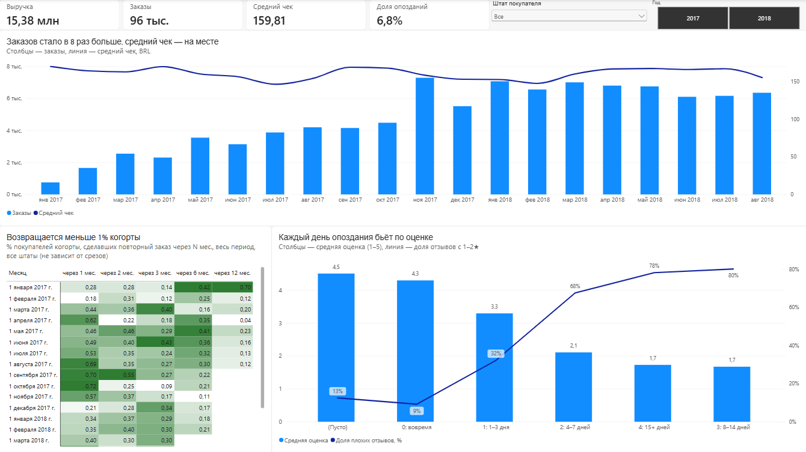
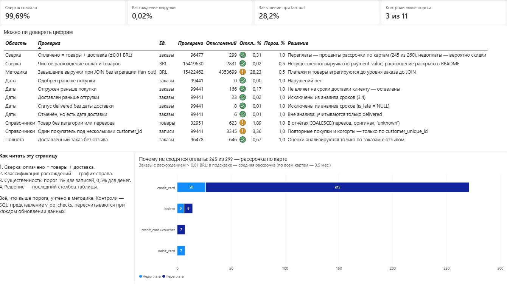
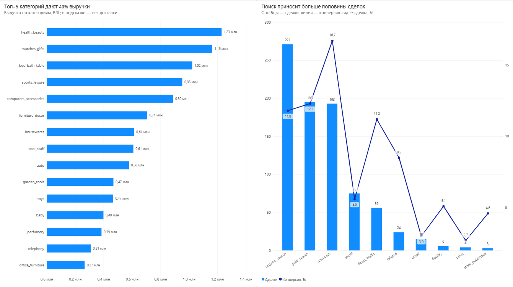
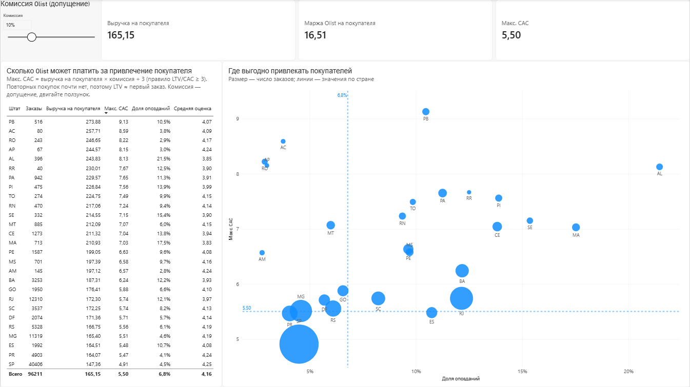

# Olist: рост без удержания — анализ бразильского маркетплейса

**PostgreSQL · SQL · Python (pandas, statsmodels) · Power BI (DAX, модель «звезда»)**

Pet-проект на открытых данных маркетплейса Olist (Бразилия, 2016–2018): ~100 тыс. заказов, отзывы, платежи, доставка и воронка привлечения продавцов. Задача — понять, за счёт чего растёт бизнес, почему покупатели не возвращаются и сколько можно тратить на их привлечение.

Особенность проекта — **аудиторский подход к данным**: прежде чем считать метрики, данные сверяются, расхождения классифицируются и оцениваются на существенность, а все решения по методике фиксируются. Результат — реестр из 11 контролей, который пересчитывается при каждом обновлении данных.



---

## Ключевые выводы

**1. Бизнес растёт за счёт новых покупателей, а не удержания.**
Число заказов в месяц выросло в 8 раз, пик — ноябрь 2017 (Black Friday): 7 289 заказов, 1,15 млн BRL. Средний чек при этом стабилен (146–170 BRL) — рост идёт за счёт числа покупателей. Но **97% покупателей купили один раз**: через месяц возвращаются 0,2–0,7% когорты, через полгода — 0,1–0,4%, и за 2017–2018 удержание не улучшилось.

**2. Одна из причин — опоздания доставки.**
Опаздывает 6,8% доставленных заказов. Средняя оценка: 4,29 у доставленных вовремя → 3,29 при опоздании на 1–3 дня → 2,11 при 4–7 днях. Доля плохих отзывов (1–2★) растёт с 9% до 68–80%. Дальше кривая выходит на плато (~1,7): клиент уже потерян, поэтому важнее всего не допускать первых дней опоздания.
Покупатели, чей первый заказ опоздал, реже возвращаются: 2,58% против 3,03% (z-тест, p = 0,044); у покупателей, у которых было не меньше полугода на возврат (первая покупка до марта 2018), разрыв ещё больше — 3,13% против 4,04% (p = 0,0066). Это связь, а не доказанная причинность — для неё предложен A/B-тест (ниже).

**3. Проблема сконцентрирована географически.**
В SP (42% заказов) опаздывает 4,5% заказов, в RJ — 12,1%, и клиенты RJ реагируют на опоздание жёстче: при опоздании на 1–3 дня плохих отзывов 40% против 32% в среднем. Улучшение логистики эффективнее начинать с RJ.

**4. Выручка сконцентрирована, доставка съедает цену в «тяжёлых» категориях.**
Топ-5 категорий из 74 дают ~40% выручки. В мебели доставка — 23–25% цены товара, в telephony у 9,5% позиций доставка дороже самого товара.

**5. Привлечение продавцов: поиск работает, атрибуция — нет.**
Конверсия лида в сделку — 10,5% (842 из 8 000), но она занижена: сделки в данных есть только с декабря 2017, и лиды 2017 года просто не успели закрыться. На корректной базе (лиды января–апреля 2018) — 13,9%, медиана закрытия 9–17 дней. Поиск (organic + paid) даёт 55% сделок. У 23% сделок источник не записан (`unknown`, конверсия 16,7%) — это не «лучший канал», а дыра в данных: нужно сделать источник обязательным в CRM. Из подписанных продавцов начали продавать только 44,7% (среди подписанных до июня 2018 — 51,3%): KPI отдела продаж стоит считать по продавцам с первой продажей, а не по закрытым сделкам.

**6. Юнит-экономика: сколько можно платить за покупателя.**
LTV покупателя за 12 месяцев — 165,96 BRL, из них первый заказ — 158,81 (повторные покупки дают лишь 4,3%). При комиссии Olist 10% (допущение) и правиле LTV/CAC ≥ 3 максимальный CAC ≈ 5,5 BRL. В дашборде комиссия — ползунок (what-if).
Высокий допустимый CAC в далёких штатах обманчив: в выручку входит дорогая доставка, а опоздания там выше. Пример: RJ — CAC выше, чем в SP (5,7 против 4,9), но опозданий вдвое больше среднего. Поэтому бюджет на привлечение разумнее направлять туда, где хорошая доставка, а в RJ сначала чинить логистику.

---

## Качество данных: можно ли доверять цифрам

Подход как в аудите: **сверка → классификация расхождений → существенность → решение**. Порог существенности: 1% для записей, 0,5% для денег. Всё, что выше порога, учтено в методике.

| Контроль | Результат | Решение |
|---|---|---|
| Оплачено = товары + доставка (±0,01 BRL) | 99,69% из 96 477 заказов сошлись | 299 расхождений классифицированы (ниже) |
| Чистое расхождение по деньгам | +2 831 BRL = 0,02% выручки | Несущественно, раскрыто |
| JOIN платежей и товаров без агрегации | Завышает выручку на 28% (19,78 млн против 15,42 млн) | Агрегация до уровня заказа до JOIN |
| Последовательность дат | 166 / 23 / 8 / 6 аномалий из 99 441 | Аномалии исключены из анализа сроков |
| Товары без категории или перевода | 623 из 32 951 (1,9%) | `COALESCE(перевод, оригинал, 'unknown')` |
| Один покупатель под разными `customer_id` | 3 345 дублей (3,4%) | Удержание считается по `customer_unique_id` |
| Доставленные заказы без отзыва | 646 (0,7%) | Оценки — только по заказам с отзывом |

**Классификация расхождений сверки:** 245 из 260 переплат — оплата кредитной картой со средней рассрочкой 6,5 мес. (по всем картам — 3,5 мес.), то есть проценты за рассрочку. Переплата по картам (3 014 BRL) полностью объясняет чистое расхождение (2 832 BRL); недоплаты (33 по картам, 6 по boleto) — скидки и округления.

**Решение по методике:** выручка в отчётах считается по `payment_value` (то, что заплатил клиент). Методологически точнее «цена + доставка», но разница 0,02% несущественна.



---

## Предложение: A/B-тест обещанной даты доставки

Связь «опоздание → нет повторной покупки» найдена на наблюдательных данных. Чтобы проверить причинность и найти решение:

- **Гипотеза:** если обещать дату доставки с запасом, доля «опозданий» с точки зрения клиента снизится, а оценки и повторные покупки вырастут.
- **Группы:** контроль — текущая обещанная дата; тест — дата + запас. Рандомизация по покупателю.
- **Целевые метрики:** доля плохих отзывов, доля повторных покупок за 90 дней.
- **Защитная метрика:** конверсия в покупку — более поздняя обещанная дата может отпугнуть часть покупателей.
- **Решение:** внедрять, только если целевые метрики значимо улучшились, а конверсия не упала сверх заранее заданного порога.

---

## Дашборд Power BI

4 страницы на модели «звезда»: факт-таблица заказов (`v_order_facts`, 1 строка = 1 заказ) + таблица дат на DAX.

| Страница | Что показывает |
|---|---|
| **Обзор** | Выручка, заказы, чек, доля опозданий; срезы «Год» и «Штат»; удержание когорт; опоздание → оценка |
| **Категории и продавцы** | Топ-15 категорий и вес доставки; воронка привлечения продавцов по каналам |
| **Юнит-экономика** | What-if комиссии → допустимый CAC; квадранты штатов «CAC × доля опозданий» |
| **Качество данных** | Реестр 11 контролей с порогами существенности; классификация расхождений сверки |

DAX: меры на `DIVIDE`/`CALCULATE`, time intelligence (`DATEADD`, `SAMEPERIODLASTYEAR`), вычисляемый столбец `SWITCH(TRUE())`, what-if параметр, линии констант по мерам.

| | |
|---|---|
|  |  |

---

## Структура репозитория

```
sql/
  01_schema.sql              DDL: 9 таблиц, PK/FK
  02_data_quality.sql        Профилирование и контроли 2.1–2.5
  03_metrics.sql             Выручка, когорты, доставка и отзывы, категории
  04_marketing_schema.sql    Схема воронки продавцов (MQL → сделки)
  04_funnel.sql              Конверсия, время до сделки, активация, LTV/CAC
  05_views.sql               Представления для Power BI
  06_model.sql               Факт-таблица v_order_facts
  07_data_quality_view.sql   Реестр контролей v_dq_checks, классификация v_recon_diff
notebooks/
  01_load_data.ipynb         Загрузка CSV в PostgreSQL (COPY)
  02_stat_tests.ipynb        z-тест долей: повторные покупки после опоздания
powerbi/
  olist_dashboard.pbix
images/                      Скриншоты дашборда
```

## Как воспроизвести

1. Скачать датасеты с Kaggle: [Brazilian E-Commerce Public Dataset by Olist](https://www.kaggle.com/datasets/olistbr/brazilian-ecommerce) и [Marketing Funnel by Olist](https://www.kaggle.com/datasets/olistbr/marketing-funnel-olist), положить CSV в `data/`.
2. Создать базу `olist` в PostgreSQL, выполнить `sql/01_schema.sql` и `sql/04_marketing_schema.sql`.
3. Запустить `notebooks/01_load_data.ipynb` (пароль запрашивается через `getpass`, в коде не хранится).
4. Выполнить `05_views.sql`, `06_model.sql`, `07_data_quality_view.sql`.
5. Открыть `powerbi/olist_dashboard.pbix` → «Обновить» (подключение `localhost`, база `olist`).

## Ограничения

- Период анализа — 2017-01 … 2018-08 (полные месяцы); сделки с продавцами в данных есть только с декабря 2017.
- Комиссия Olist неизвестна — 10% взято как допущение, в дашборде её можно менять.
- Связь опозданий с повторными покупками — наблюдательная; для причинности нужен эксперимент.
- У 23% сделок с продавцами не указан источник — выводы по каналам привлечения с этой оговоркой.
